# Sidecar for OpenCode

**The complete OpenCode experience inside VS Code.** Sidecar puts the [OpenCode](https://opencode.ai) coding agent in a chat panel beside your code: every step on one timeline, live subagents you can open and stop, permission requests and questions answered where you type, `@` mentions, images, fork and rewind, and the agent's edits in VS Code's own diff editor.

  

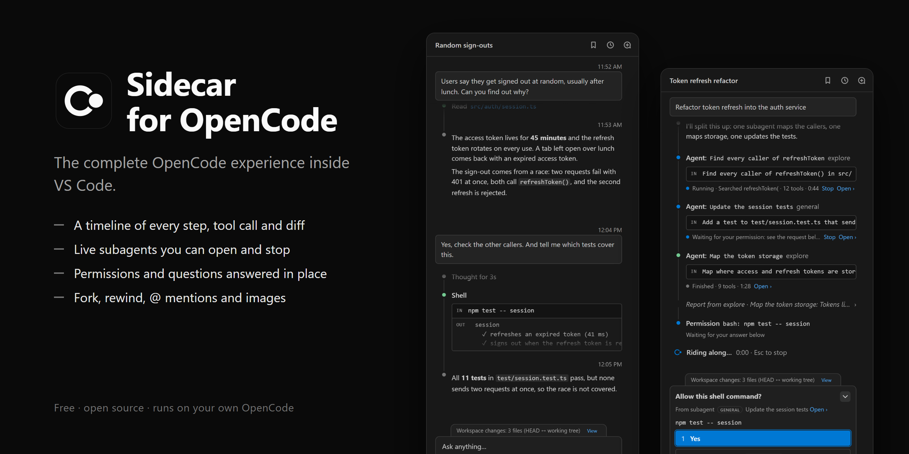

Free and open source. An independent community project, not affiliated with OpenCode; the official OpenCode extension is `sst-dev.opencode`.

## Why Sidecar

OpenCode is a capable agent. Sidecar is built so you can see and steer everything it does without leaving the editor.

- **Built on OpenCode's own API.** Sidecar talks to the OpenCode 2 service on your machine through its v2 HTTP API. Your sessions, models, providers, agents, commands, skills and permission rules are OpenCode's, so nothing is locked in: open the same session in OpenCode's terminal UI and Sidecar follows along, including rewinds and model changes made there.
- **Nothing hidden.** Each prompt gets a timeline of what the agent did: thinking time, every tool call with its input and output, diffs with your theme's syntax colors, and each subagent with its exact prompt, live activity and report.
- **You stay in control.** Nothing is ever approved for you. Permission requests, including those raised deep inside a subagent, wait in place of the message box until you answer, and you can tell the agent what to do instead. Budget Guard stops a runaway task at a cost or step limit you choose.
- **Made for VS Code.** Theme colors only (dark, light and high contrast), a layout that works from a 300 px side bar to a wide editor tab, keyboard access throughout, native notifications, and editor tabs for long output.
- **Private by design.** Sidecar connects only to your local OpenCode service, sends nothing anywhere else and collects no telemetry. It is tested with hundreds of unit tests and a headless-browser suite, and its OpenCode calls are checked against a live OpenCode 2 service.

## OpenCode coverage

| OpenCode                                   | In Sidecar                                                                                     |
| ------------------------------------------ | ---------------------------------------------------------------------------------------------- |
| Sessions                                   | History with search, rename, fork from any prompt, archive and restore, new session            |
| Prompts and delivery                       | Send, **steer** the running task or **queue** the next message; edit or remove pending ones    |
| Agents and models                          | Agent switch (Shift+Tab), models by provider, variants, defaults per workspace                 |
| Tools                                      | A timeline row per call: shell IN/OUT, reads, edits with diffs, writes, searches, and the rest |
| Subagents                                  | Live rows with prompt, activity, Stop and Open; their requests and reports come back to you    |
| Permissions                                | Yes, Always allow (when offered), No, or No with an instruction for the agent                  |
| Questions                                  | A tabbed form with options, an Other answer and descriptions                                   |
| Commands and skills                        | The `/` palette with OpenCode's commands (yours too), `@skill` and `@agent` mentions           |
| Context                                    | Files, folders and selections, `@` mentions found by OpenCode's search, pasted images          |
| Rewind                                     | Rewind with or without code, and Restore or Apply a rewind staged in another client            |
| Shell, compaction                          | `!command`, `/compact`                                                                         |
| Usage                                      | Context, cost, steps, cache hits and a prompt-cache estimate                                   |
| Agent changes                              | Kept apart from your own edits, in VS Code's diff editor                                       |
| Other clients (terminal UI, other windows) | Followed live: new sessions, renames, rewinds, agent and model choices                         |

## A tour

- **One timeline per prompt.** A dot per step: text, thinking time, every tool call and every subagent. The prompt you're reading stays pinned while you scroll, and **Rewind ↺** takes the session back to just before it.
- **Readable tool calls.** Shell commands as IN/OUT boxes, reads as file links, edits as changed lines with your theme's syntax colors (click for the diff editor). Click IN, OUT or a subagent's prompt to open it in full in an editor tab. Prefer it compact? Set `opencodeSidecar.activity` to `grouped`.
- **Live subagents.** Each one shows its task, prompt, current activity, tool count and time, with **Stop** and **Open ›** into its own conversation. Its report comes back as one line you can expand.
- **Answer where you type.** Permission requests and questions replace the message box until answered: _1 Yes_, _2 Yes, always allow_ (when OpenCode offers it), _3 No_, or type what the agent should do instead. Nothing is ever approved for you, and sensitive paths get a warning.
- **A message box with everything at hand.** Type **@** to mention a file, folder, subagent or skill. Paste or drop a screenshot, or use **+** for a file, the selection, a workspace search or an image. **/** opens the action palette: OpenCode's commands, `/compact`, `!command`, model, session and settings. The ◷ clock estimates the prompt cache. The model pill has variant and Budget Guard sliders. Shift+Tab switches the agent. While the agent works you can **steer** it or **queue** your next message.
- **Guard rails.** Budget Guard stops runaway tasks at a local cost or step limit. Agent changes are kept apart from your workspace changes. Native notifications tell you when a task completes, needs input, fails or is stopped.
- **Sessions.** **Fork** a conversation from any prompt into a new session, **archive** sessions you are done with, and search **History**. **Copy** and **Bookmark** sit under every final answer.

|                                                                    Timeline                                                                    |                                                               Tool calls                                                               |                                                                           Subagents                                                                            |
| :--------------------------------------------------------------------------------------------------------------------------------------------: | :------------------------------------------------------------------------------------------------------------------------------------: | :------------------------------------------------------------------------------------------------------------------------------------------------------------: |
| 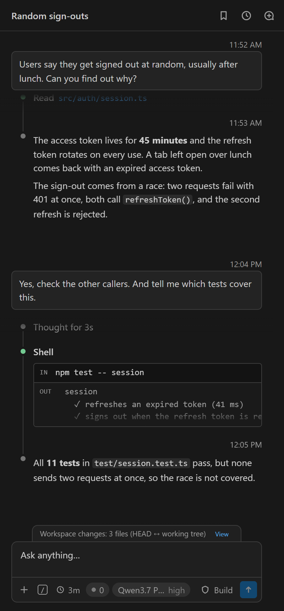 | 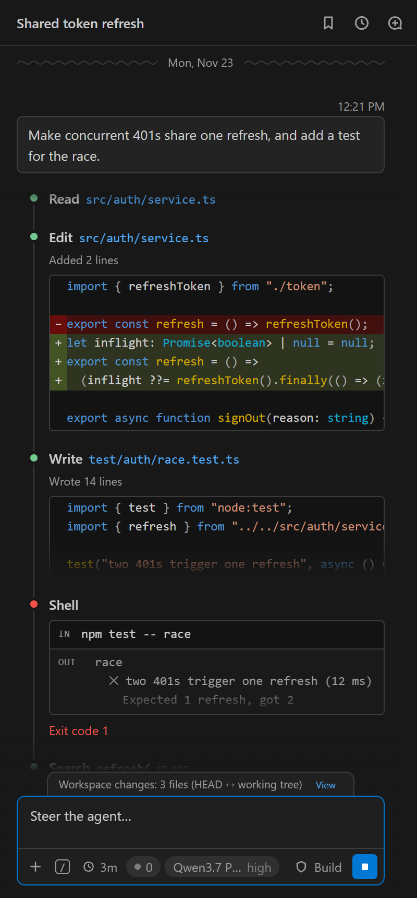 |                   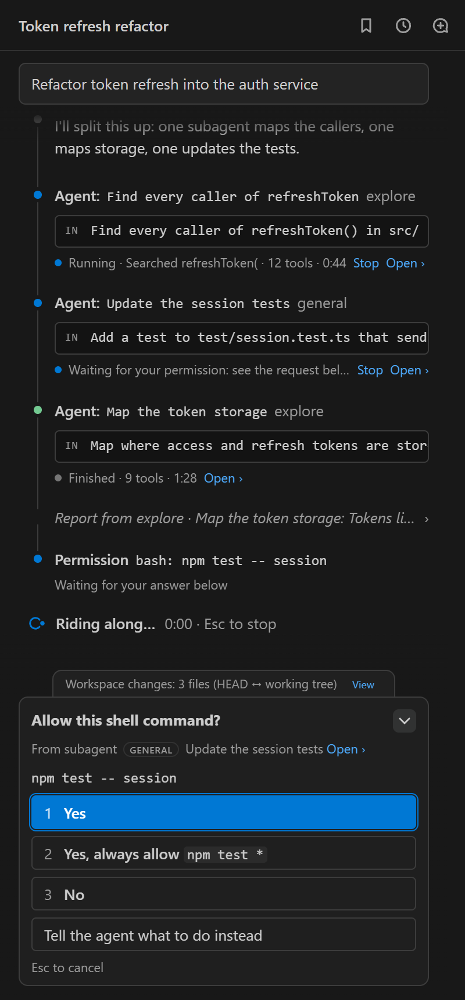                   |
|                                                             **A subagent's view**                                                              |                                                              **Question**                                                              |                                                                       **Action palette**                                                                       |
|     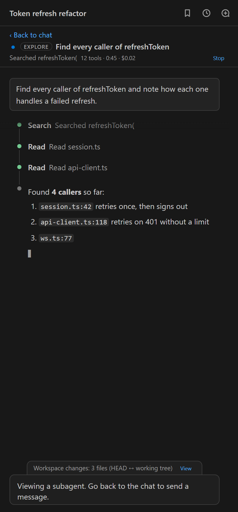     |      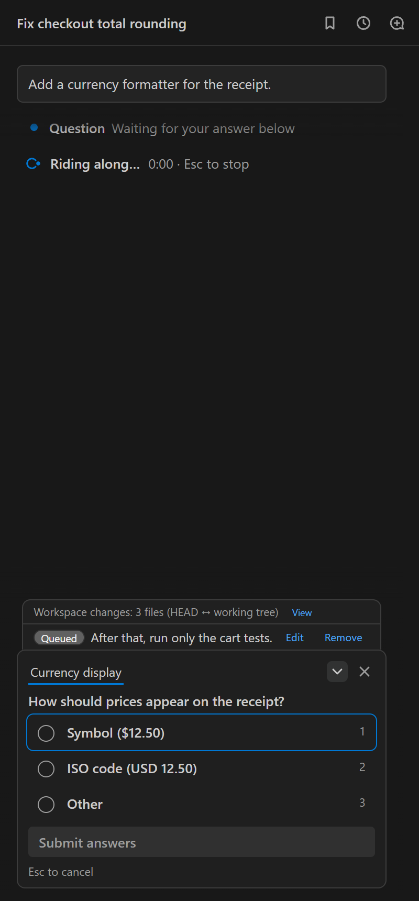      |                    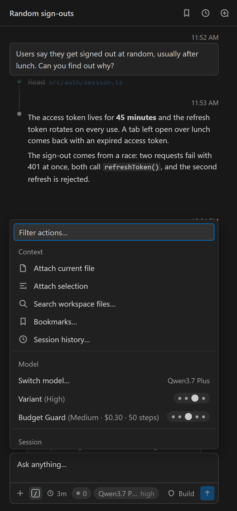                     |
|                                                              **Cache and usage**                                                               |                                                             **Bookmarks**                                                              |                                                                         **@ mentions**                                                                         |
|        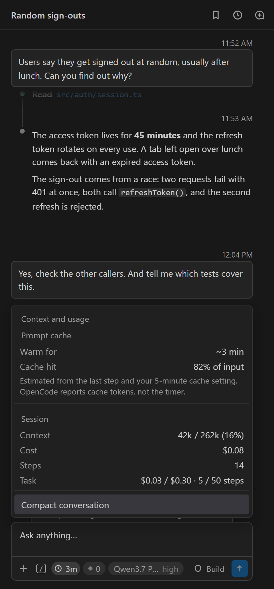        |            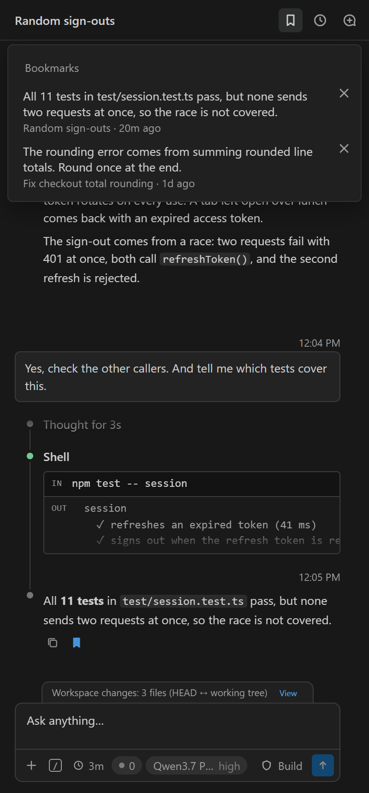             | 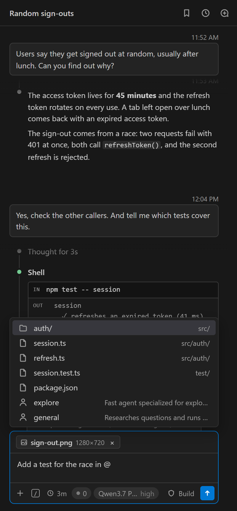 |
|                                                                **Budget Guard**                                                                |                                                           **Agent changes**                                                            |                                                                         **First run**                                                                          |
|   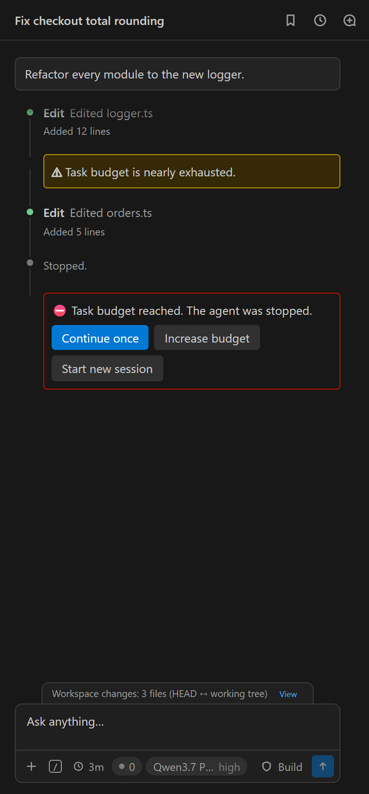   |  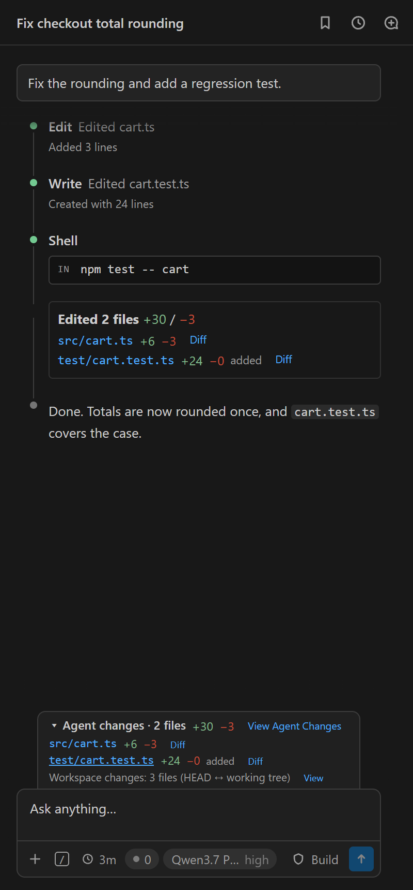  |               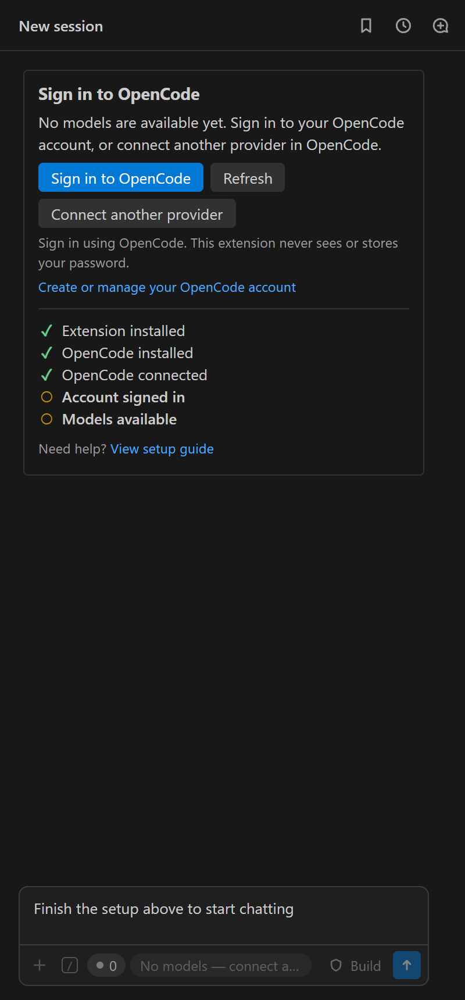                |

## Requirements

- VS Code 1.95 or newer, in a trusted workspace (Sidecar is disabled in Restricted Mode).
- [OpenCode](https://opencode.ai) **2.x** with its background service. OpenCode 1.x is not supported.
- A model in OpenCode: its free models, your OpenCode account, or another provider connected in OpenCode. Usage and costs are between you and your provider.

## Getting started

1. Install **Sidecar for OpenCode** from the Extensions view.
2. Click the **Sidecar** icon in the Activity Bar or the Status Bar.
3. Follow the setup card if something is missing. **Install OpenCode** opens [the official install guide](https://opencode.ai/docs#install), **Start OpenCode** runs `opencode service start`, and **Sign in to OpenCode** runs OpenCode's own sign-in in a terminal. The card disappears once everything is ready, so if you already use OpenCode you won't see it.
4. Pick a model in the model pill and start chatting.

**Tip:** drag the Sidecar icon to the **Secondary Side Bar** so the chat sits beside your editor. The panel works from about 300 px wide.

## Using Sidecar

| Key                  | Where              | What it does                             |
| -------------------- | ------------------ | ---------------------------------------- |
| Enter / Shift+Enter  | Message box        | Send / new line                          |
| @, ↑/↓, Enter or Tab | Message box        | Mention: open the list, move, pick       |
| Esc                  | Message box        | Stop the running task                    |
| Shift+Tab            | Message box        | Switch the agent (Build ↔ Plan)          |
| 1, 2, 3 / Esc        | Permission request | Pick an answer by its number / No        |
| 1–9, ←/→, Esc        | Question           | Pick an option, switch questions, cancel |
| ←/→                  | Slider in a menu   | Change the variant or Budget Guard level |
| Cmd+Alt+O (macOS)    | Anywhere           | Focus the chat                           |

On Windows and Linux, add your own shortcut for `opencodeSidecar.focusChat` (Ctrl+Alt types characters on many keyboard layouts).

- **Mentions.** Type `@` and pick from the list, or keep typing to search: files and folders (found by OpenCode), subagents such as `@explore`, and OpenCode's skills. OpenCode reads mentioned files itself, and a mentioned subagent or skill is passed to the agent as such.
- **Images.** Paste or drop a PNG, JPEG, GIF or WebP into the message box, or pick image files with **+ → Attach image…**. Very large screenshots are scaled down. Sidecar tells you when the selected model doesn't list image input in OpenCode.
- **Commands.** Type `/` for the palette, or type `/name arguments` directly. OpenCode's built-in commands (such as `/init` and `/review`) and any you define are listed for the folder. `!git status` runs a shell command through OpenCode.
- **Rewind.** Hover a prompt for ↺ (and Fork). Rewind asks first in a dialog, then removes that prompt and everything after it from the session. _Rewind conversation and code_ also undoes OpenCode's file changes since then. Rewind cannot be undone and is available while the agent is idle.
- **Fork and archive.** Hover a prompt and click **Fork** to continue in a new session that has the conversation before that prompt (the prompt goes into the message box). **Fork session** in the `/` palette copies the whole conversation. The original stays as it was. **Archive** a session from History or the palette; History's **Archived sessions** lists them with **Restore**.
- **Steer and queue.** While the agent works, Enter either adds your instruction at its next step (steer) or runs it after the task (queue), as chosen in the agent menu. Messages not yet delivered are listed above the box with **Edit** and **Remove**.
- **Budget Guard** is a local per-task limit on cost and steps, set in the model menu. It warns at 80% and then stops the agent through OpenCode's own cancellation, offering **Continue once**, **Increase budget** or **Start new session**. Defaults: Small $0.10 / 20 steps, Medium $0.30 / 50, Large $1.00 / 120, Custom $0.50 / 80. If OpenCode reports no cost, only steps count.
- **Prompt cache clock.** It counts down `opencodeSidecar.cacheWarmMinutes` (default 5) from the last step. This is an estimate, because OpenCode reports cache tokens but not your provider's timer. Set it to `0` to hide the clock.
- **Agent changes** come from OpenCode's session snapshots, so edits you already had are not counted. **Workspace changes** is the usual HEAD ↔ working tree. When the agent's changes can't be told apart, Sidecar says so instead of guessing.
- **Other clients.** Rewinds, agent and model choices, and session changes made in OpenCode's TUI or other clients show up in Sidecar. A rewind another client has staged but not applied (such as `/undo`) hides the messages it removes, with **Restore** to bring them back or **Apply** to remove them for good. Restoring them lets OpenCode carry on with anything still queued for the session.

### Commands

| Command                      | What it does                                                     |
| ---------------------------- | ---------------------------------------------------------------- |
| Sidecar: Focus Chat          | Reveal the chat and focus the message box                        |
| Sidecar: Refresh Connection  | Re-check OpenCode, account, providers, models and agents         |
| Sidecar: Sign in to OpenCode | Run OpenCode's own sign-in in a terminal                         |
| Sidecar: New Session         | Start a fresh conversation                                       |
| Sidecar: Add Current File    | Attach the active editor's file                                  |
| Sidecar: Add Selection       | Attach the selected lines; also in the editor's right-click menu |
| Sidecar: Stop                | Cancel the running task                                          |

### Settings

| Setting                                            | Default    | Description                                                                                                            |
| -------------------------------------------------- | ---------- | ---------------------------------------------------------------------------------------------------------------------- |
| `opencodeSidecar.executablePath`                   | empty      | Path to `opencode`; empty searches `PATH` and common install locations.                                                |
| `opencodeSidecar.serverUrl`                        | empty      | Use a specific OpenCode server instead of the local background service.                                                |
| `opencodeSidecar.allowRemoteServer`                | `false`    | Allow `serverUrl` to point at a non-loopback host.                                                                     |
| `opencodeSidecar.defaultModel`                     | empty      | `providerID/modelID` to preselect for new workspaces.                                                                  |
| `opencodeSidecar.defaultAgent`                     | empty      | Agent to preselect, such as `build` or `plan`.                                                                         |
| `opencodeSidecar.autoStart`                        | `false`    | Start the OpenCode background service when the view opens.                                                             |
| `opencodeSidecar.stickyPrompt`                     | `true`     | Keep the prompt of the turn you're reading pinned.                                                                     |
| `opencodeSidecar.statusWords`                      | `true`     | A playful word per run (such as _Riding along…_) next to the turning mark while the agent works; off shows _Working…_. |
| `opencodeSidecar.activity`                         | `detailed` | `detailed` shows every tool call; `grouped` folds runs of calls into a line.                                           |
| `opencodeSidecar.cacheWarmMinutes`                 | `5`        | Your provider's prompt-cache lifetime for the clock; `0` hides it.                                                     |
| `opencodeSidecar.showUsage`                        | `true`     | Show context, cost and step figures.                                                                                   |
| `opencodeSidecar.showStatusBarItem`                | `true`     | Show the Sidecar item in the Status Bar.                                                                               |
| `opencodeSidecar.budget.default`                   | `medium`   | Budget level for workspaces without a saved choice.                                                                    |
| `opencodeSidecar.budget.small/medium/large/custom` | see above  | `{ "maxCost": USD, "maxSteps": n }`; `0` disables that metric.                                                         |
| `opencodeSidecar.budget.warnPercent`               | `80`       | Warn at this share of the budget.                                                                                      |
| `opencodeSidecar.budget.contextWarnPercent`        | `80`       | Warn when the context window is this full; `0` turns it off.                                                           |
| `opencodeSidecar.notifications.*`                  | `true`     | `taskComplete`, `needsInput`, `taskFailed` and `budgetStopped` notifications.                                          |

## Privacy and security

- Sidecar talks only to **your local OpenCode service** (loopback unless you allow a remote server). It has **no telemetry** and no service of its own.
- **No credentials are stored or requested.** Sign-in and providers are handled by OpenCode; the local service password stays in memory.
- **Workspace content is sent only when you attach or `@`-mention it**, or when the agent reads it through OpenCode's tools under OpenCode's permission rules. Pasted images go to OpenCode with the prompt and nowhere else.
- Nothing is approved automatically. The view runs under a strict content security policy, and every message from it is validated. Logs leave out prompts and file contents and redact secrets.
- Bookmarks (a short excerpt and its session title) are stored locally in VS Code's workspace storage.

Details are in [SECURITY.md](https://github.com/charlesknapp/opencode-sidecar/blob/main/SECURITY.md).

## Known limitations

- Requires OpenCode 2.x and its background service.
- OpenCode reads attached files from disk, so unsaved editor changes are not included (you'll get a reminder).
- The prompt cache clock is an estimate, and provider quotas are not available from OpenCode.
- Reopening a session loads its most recent 400 messages.
- The interface is in English, with a few strings in Arabic.

## FAQ

**What is Sidecar for OpenCode?**
A free, open-source VS Code extension that gives the OpenCode coding agent a full chat interface inside the editor. It works with the OpenCode 2 service already on your machine.

**Is it official?**
No. It is an independent community project and is not affiliated with OpenCode. The official OpenCode extension is `sst-dev.opencode`.

**Do I need an API key, and what does it cost?**
Sidecar is free and needs no key of its own. It uses the models you have in OpenCode: OpenCode's free models, your OpenCode account, or any provider you connect in OpenCode. Model costs are between you and your provider.

**Does it work with my existing OpenCode sessions?**
Yes. Sessions are OpenCode's, so the ones you started in the terminal UI appear in History, and changes made in either place show up in the other.

**Does my code leave my machine?**
Sidecar sends your prompts and the files you attach only to your local OpenCode service. What OpenCode then sends to a model provider is decided by OpenCode and your configuration.

**Which platforms does it run on?**
Wherever VS Code 1.95+ and OpenCode 2.x run: Windows, macOS and Linux. It needs a trusted workspace.

## About

Sidecar for OpenCode is an independent, community-built extension. It is not affiliated with, sponsored by or endorsed by OpenCode or its authors; "OpenCode" is used only to say which agent it works with.

## License

MIT. See [LICENSE](https://github.com/charlesknapp/opencode-sidecar/blob/main/LICENSE). Source, issues and releases: https://github.com/charlesknapp/opencode-sidecar
